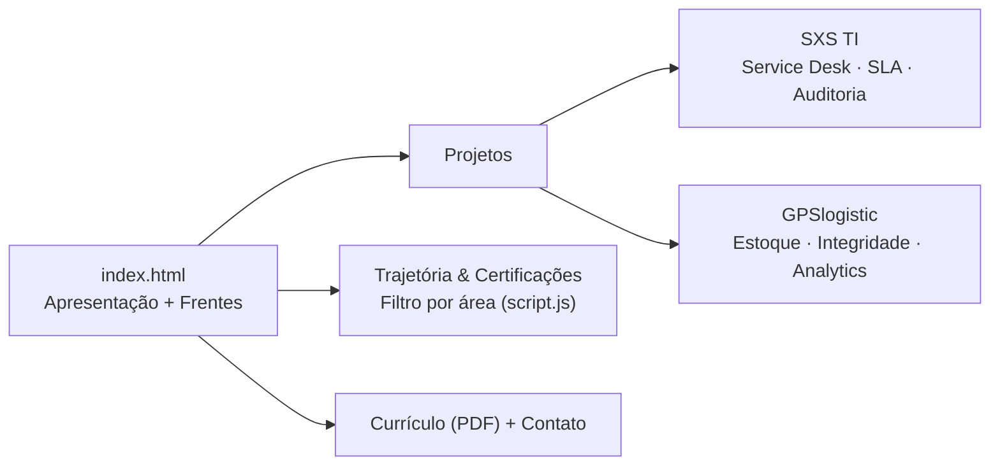

# Portfólio | Samuel Xavier Sampaio

Site estático em HTML, CSS e JavaScript puro reunindo meus projetos de TI, formação, certificações e currículo para vagas de estágio em **Cibersegurança**, **Análise de Dados** e **Suporte de TI**.

## Estrutura

## Arquivos

- `index.html`: estrutura semântica das seções (apresentação, frentes de atuação, SXS TI, GPSlogistic, experiência, cursos e contato).
- `style.css`: tema escuro técnico responsivo sem frameworks externos.
- `script.js`: filtro interativo de cursos por área, cópia rápida de e-mail e destaque da seção ativa.
- `curriculo-samuel-sampaio.pdf` e `curriculo-samuel-sampaio-revisado.docx`: currículo disponível para download direto.
- `assets/favicon.svg`: ícone do site.

## Como abrir ou publicar

Não há build nem dependências. Para testar localmente, basta abrir `index.html` no navegador ou subir os arquivos na raiz do repositório configurado para **GitHub Pages**.
